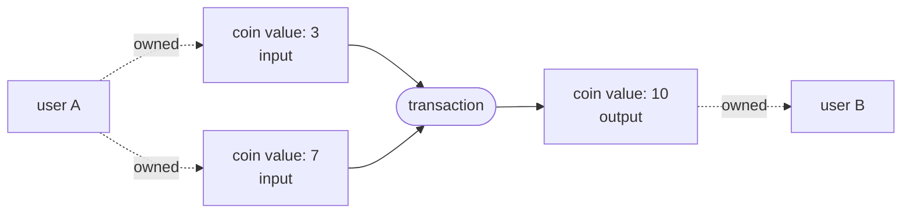

# Equity

A Go REST API for a cross-platform activity-reward economy. User activity (chat messages so far) is buffered in memory and periodically settled into **coins modeled as UTXOs** in MariaDB, so every coin traces back to the transaction that created it.

Includes a Twitch chat traffic simulator and a React Flow webapp for exploring the economy.

## Highlights

- **UTXO ledger.** Coins are immutable rows; transactions link coins as `input` or `output`. A coin can appear at most once as each (`UNIQUE (coin_id, link_type)`), enforced by the database.
- **One identity across platforms.** Each user gets a ULID (`unid`); Discord, Minecraft, etc. are mapped to it through per-platform tables.
- **Batched, atomic payouts.** A mutex-guarded in-memory buffer (`platform > activity type > user > activity objects`) is drained by a scheduler and settled in a single DB transaction. Any failure rolls the whole batch back.
- **Extensible by design.** Platforms, activity types and transaction reasons are enums plus link maps. Every extension point is tagged `NOTE: NEW_PLATFORM` / `NEW_ACTIVITY` / `NEW_TRANSACTION_REASON`, so `grep NOTE: NEW_` lists everything to touch.
- **Generic request handling.** `HandleRequest[T, R]` decodes, validates and runs any handler, so a new endpoint is just a request struct and a function.
- **Plain stdlib + sqlc.** `net/http` (method/path-pattern routing), type-safe queries generated by sqlc, `slog` logging (text to stdout, JSON to file), request-ID / logger / panic-recovery / CORS middleware.

## Visualizing the ledger

Relational ledger data is hard to read as rows, but it is naturally a graph. The webapp uses [React Flow](https://reactflow.dev/) so you can explore the UTXO ledger by expanding nodes instead of writing joins. *(In progress: the prototype can spawn user nodes today; transaction and coin expansion is the next step.)*

Spawn a transaction, then right-click nodes to pull in what is connected to them:

- **Right-click a transaction** to spawn its participants, e.g. user A and user B.
- **Right-click the paying user** and choose "involved coins" to spawn the coins A spent as inputs.
- **Right-click the receiving user** and choose "involved coins" to spawn the new coins created for B as outputs.

For a transaction where A paid B 10, built from two of A's coins (3 and 7), the graph reads:



Every node maps directly to a table (`users`, `coins`, `transactions`) and every edge to a `transaction_links` row, so the graph is the schema made visible.

## API

| Method | Path | Purpose |
|---|---|---|
| `POST` | `/api/equity/message` | Report a message: `{"platform_name","platform_id","message_length"}` |
| `GET` | `/api/webapp/pending-payouts` | Buffer size and a snapshot of the queue |
| `GET` | `/api/webapp/user/{unid}` | `{"result": true\|false}`, whether the user exists |

```bash
# first call creates the user, later calls are enqueued for the next payout
curl -X POST localhost:6767/api/equity/message \
  -d '{"platform_name":"discord","platform_id":"123","message_length":42}'
```

## Project layout

```
api/      Go API (src/, sqlc queries + generated code in sql/)
sim/      Twitch chat -> API traffic simulator
webapp/   React + TypeScript + Vite + React Flow
compose.yml, makefile, flake.nix
```

## Running locally

Requires Docker and Go 1.26+ (`nix develop` provides Go).

```bash
# 1. config, in the repo root
cp example.env .env

# 2. database (+ Adminer on :8080) and webapp (http://localhost:5173)
docker compose up -d mariadb adminer webapp-dev

# 3. API (schema and preset rows are created on startup)
make api

# 4. optional: generate traffic from live Twitch chat (channels in sim/config.json)
make sim
```

Regenerate query code after editing `api/sql/queries/*.sql` with `make sqlc`.

## Status

Working: user identity, message activity, batched genesis payouts, user lookup, node-graph prototype in the webapp.

Planned:
- Spending/transfers (the schema already supports `input` links) and auctions (table defined, not wired up)
- More activity types, with payout evaluation using time gaps between messages
- Transactions and Payouts pages in the webapp (stubs for now)
- API Dockerfile and Compose service
